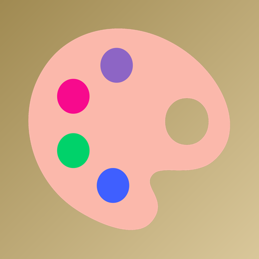
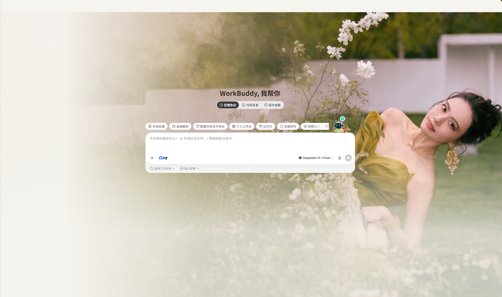
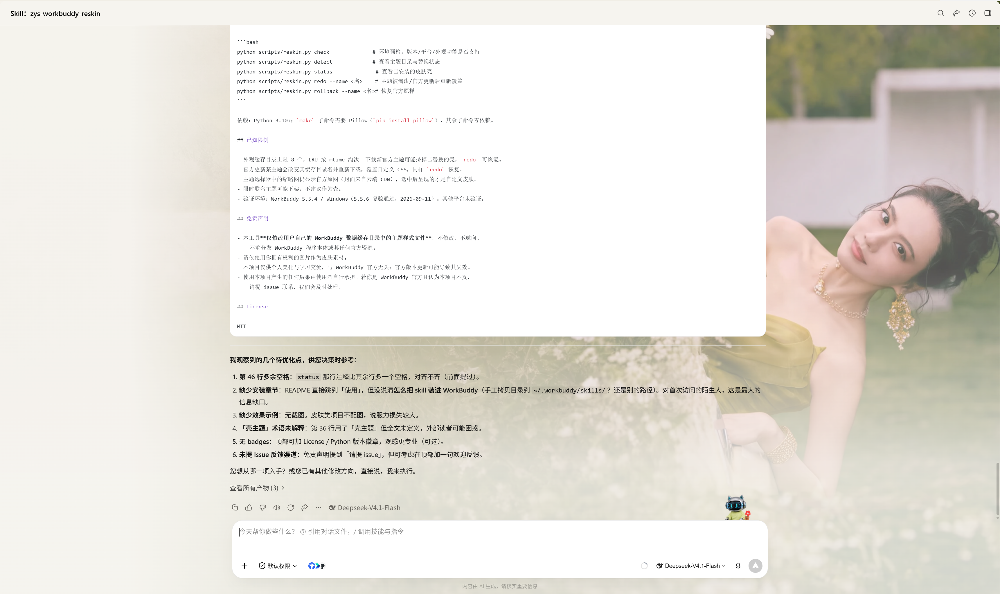

<p align="center">
  
</p>

<h1 align="center">WorkBuddy 换肤（ZYS WorkBuddy Reskin）</h1>

<p align="center">
  <a href="LICENSE"></a>
  <a href="https://www.python.org/"></a>
  <a href="#适用环境重要"></a>
  <a href="#版本"></a>
</p>

把任意一张图片变成 WorkBuddy 桌面端的主题皮肤——背景图与整套配色一起换。

提供**两种用法**：

- **省心版（默认）**：写入全部可用主题，重启后在「外观」里点一下其他主题即可恢复；
- **全自动版（可选）**：桌面官方图标启动 + 后台守护，开机自动恢复，全程无需操作。

> 由 [workbuddy-skin-studio](https://github.com/cdredfox/workbuddy-skin-studio) 项目启发，
> 实现完全独立：纯 Python 标准库 + Pillow，单文件 CLI。

## 效果示例

| 首页 | 会话页 |
| :---: | :---: |
|  |  |

上图为使用一张人物图自动取色生成的效果：主色取自图片暖金调，首页背景整体铺陈、
会话内容区覆盖 33% 薄纱以保证文字可读。

## 安装

把下面这句话发给 WorkBuddy：

```
请帮我安装这个技能：https://github.com/zhouyubing/zys-workbuddy-reskin
```

WorkBuddy 会拉取仓库并安装到技能目录。安装后无需额外配置，直接在会话里说「换肤」即可。

## 工作原理

### 一、借壳官方主题

WorkBuddy 把服务器主题缓存于 `~/.workbuddy/appearance-resources/theme-<key>-<updatedAt>/`，
核心是一份 `skin*.css`。本工具把自包含的皮肤 CSS 写入这些目录，借官方主题的位置生效。

### 二、配色来自官方底稿（v1.3.0 起）

WorkBuddy 5.8.x 的界面使用 **650+ 个 CSS 设计变量**（以 `--wb-*` 为主）。只覆盖其中少数变量，
会出现「背景图生效、配色仍是官方」的现象。

因此 v1.3.0 改用 **官方 CSS 底稿 + 整体色相偏移**：

1. 读取该主题的官方原版 CSS；
2. 计算「官方强调色 → 目标主色」的色相差，对全部 hex / `rgb()` / `rgb(r g b / a%)` 形式颜色整体偏移；
3. 替换壁纸引用，并叠加结构补丁（薄纱 / 磨砂 / 顶栏）。

这样**全部变量一次迁移**，且能跟随后续界面改版（结构规则直接继承官方）。

### 三、写入全部可用主题（多壳）

5.8.3 起，「当前主题」在启动时会被官方包覆盖，本地文件无法阻止。
所以 v1.3.0 默认把皮肤写入**全部可用主题**（按主题 key 去重取最新目录）：

- 切到**任意其他主题** → 读到磁盘自定义 CSS，皮肤生效；
- **当前主题**启动时 → 官方包覆盖（不可避免），切一下即恢复。

这就是「省心版」只需点一下的原因。完整机制见
[`references/mechanism-5.8.md`](references/mechanism-5.8.md)。

## 适用环境（重要）

| 条件 | 要求 |
| --- | --- |
| 客户端 | WorkBuddy **桌面端** |
| 版本 | **≥ 5.5.3**（外观功能自 5.5.3 上线）；**5.8.x 按「省心版 / 全自动版」策略运行** |
| 账号 | **个人版**（外观功能不对企业版开放） |
| 平台 | **Windows**（全自动方案的快捷方式与开机自启依赖 Windows；macOS 仅支持省心版的手动流程） |
| 不支持 | 小程序端、手机 App 端 |

首次使用时 skill 会自动运行环境预检（`python scripts/reskin.py check`）。

## 使用

安装后在会话里说「**换肤**」即可，AI 会引导完成。**两种方案任选**：

| | **省心版**（默认） | **全自动版** |
|---|---|---|
| 每次开机后 | 在「外观」里点一下其他主题 | **什么都不用做** |
| 需要准备 | 无 | 改用桌面「WorkBuddy-换肤版」图标启动 |
| 适合 | 偶尔重启 / 长期不关机 | 每天开关机、想完全无感 |
| 依赖 | 无 | 后台守护（登录时自启） |

### 常用命令

```bash
python scripts/reskin.py check                          # 环境预检
python scripts/reskin.py detect                         # 查看主题目录与替换状态
python scripts/reskin.py make --image <图> --name <名>   # 生成皮肤（自动用官方底稿取色）
python scripts/reskin.py apply --name <名> --all-carriers   # 写入全部可用主题（默认推荐）
python scripts/reskin.py status                         # 查看皮肤及其覆盖的主题
python scripts/reskin.py doctor                         # 健康自检
python scripts/reskin.py doctor --fix                   # 一键修复失效皮肤
python scripts/reskin.py rebuild --name <名> --from-official  # 以官方底稿重建
python scripts/reskin.py redo --name <名>                # 重新覆盖到全部载体
python scripts/reskin.py rollback --name <名>            # 恢复官方原样（逐个还原）

# 全自动方案
python scripts/guard.py install                         # 生成桌面快捷方式 + 开机自启
python scripts/guard.py status                          # 查看安装与运行状态
python scripts/guard.py once                            # 诊断：单次检查并打印结果
python scripts/guard.py uninstall                       # 卸载（皮肤保留）
```

## 皮肤失效了怎么办？

| 现象 | 原因 | 处理 |
| --- | --- | --- |
| 重启后变回官方主题 | 5.8.3 会覆盖「当前主题」 | **正常现象**：外观里点一下其他主题即可 |
| 点了还是官方 | 官方更新了该主题（目录版本号变化） | `doctor --fix` 或 `redo --name <名>` |
| 界面变空白 / 全浅色 | 主题包被破坏或断网 | 「外观」重新选一次主题；或 `rollback` 后重做 |
| 换了图但配色没变 | 用了旧版模板（只覆盖少数变量） | `rebuild --name <名> --from-official` |
| 全自动没生效 | 用了原来的图标启动 | 改用「WorkBuddy-换肤版」图标 |

## 已知限制

1. **「当前主题」无法跨重启保持**——5.8.3 启动时会强制刷新官方包。这是客户端行为，非本工具缺陷。
   省心版靠「切一下主题」规避，全自动版靠后台守护对冲。
2. **全自动方案需要客户端以调试端口启动**——仅监听 `127.0.0.1`，不联网、不上传任何数据；
   不需要时可随时卸载，皮肤本身不受影响。
3. **限时活动主题**（如联名款）过期后目录会残留但不再显示；写入无副作用，`doctor` 会标注为「过期残留」。
4. **壁纸体积受限**：单个主题 CSS 需 ≤ 500 KB（客户端校验）；本工具会自动压缩壁纸达标。
5. 企业版 / 小程序端无外观功能，不支持。

## 版本

| 版本 | 主要变化 |
| --- | --- |
| **1.3.0** | 新增「省心版 / 全自动版」双方案；配色改用官方底稿整体色相偏移（覆盖 650+ 变量）；`apply` 支持写入全部可用主题；`redo` / `rollback` / `doctor` 同步支持多壳；新增 `references/mechanism-5.8.md` |
| 1.2.0 | 适配 5.6.2 皮肤机制 v2；新增 `rebuild` 重建命令 |
| 1.1.0 | 新增 `doctor` 健康自检与一键修复 |
| 1.0.0 | 首版：图片取色 → 生成 CSS → 借壳官方主题 |

## 免责声明

本项目通过修改 WorkBuddy 本地主题缓存文件实现换肤，属于对客户端本地资源的自定义。
使用前请知晓：

- 客户端升级可能改变主题机制，导致皮肤失效（本工具提供修复命令，但不保证永久兼容）；
- 修改前会自动备份官方原样，可随时 `rollback` 还原；
- 请使用你拥有合法使用权的图片作为壁纸；
- 本项目与 WorkBuddy 官方无关，仅供个人学习与自用。

## 反馈与贡献

欢迎提 Issue 反馈问题或建议。提交前请先运行 `python scripts/reskin.py doctor` 并附上输出，便于定位。

## License

[MIT](LICENSE)
